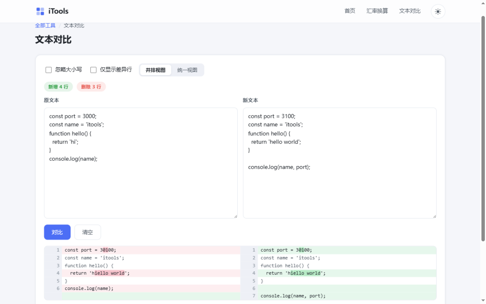

# iTools · 轻量在线工具箱

> 轻量、清爽、本地优先的在线工具聚合站 —— 无框架、无构建步骤，`npm start` 即跑

一个用 Node.js 原生 ESM + Express + 内置 SQLite 实现的在线工具箱。首期内置 6 个常用工具，所有"本地处理"工具均在浏览器内完成、数据不上传服务器；整体零框架、零构建，克隆下来就能跑。

## ✨ 功能一览

| 工具 | 路由 | 执行位置 | 亮点 |
|---|---|---|---|
| 🔐 随机密码生成 | `/tools/password/` | 服务端 | `node:crypto` 强随机（拒绝采样无模偏差），保证每种已选字符类至少出现一次，Fisher–Yates 洗牌；符号集自定义自动去重；限流 60 次/分钟/IP |
| 💱 汇率换算 | `/tools/exchange/` | 服务端 + 定时任务 | 13 种常用币种互转，每 6 小时自动抓取落库（双数据源互备），断网时回退库内缓存并提示"数据可能滞后" |
| 🆔 UUID 生成 | `/tools/uuid/` | 浏览器 | Web Crypto `crypto.randomUUID` 批量生成，大写 / 去连字符可叠加 |
| 🔒 MD5 加密 | `/tools/md5/` | 浏览器 | 输入即算，一次返回 32/16 位大小写四种结果（纯 JS 实现，与 node:crypto 双重校验） |
| 🔤 大小写转换 | `/tools/case/` | 浏览器 | 六种模式：全大写 / 全小写 / 单词首字母 / 句首字母 / 大小写反转 / 驼峰命名，中文保留原样 |
| 📝 文本对比 | `/tools/diff/` | 浏览器 | **自研 Myers O(ND) diff 引擎**（trace 回溯，内存有界）：左右分栏行号严格对齐、行内字符级高亮、并排/统一双视图、忽略大小写、仅看差异行，超长文本自动让出主线程 |

首页支持按名称 / 描述 / 关键词实时过滤工具卡片，顶栏导航与页脚文字集中在 `src/site-config.js` 一个文件里，改完即生效。

## 📸 截图

**首页（浅色 / 深色）**


**文本对比** —— 自研 Myers 引擎，行级对齐 + 行内字符级高亮：



**随机密码生成**（服务端强随机）：


**汇率换算**（每 6 小时自动更新）：


## 🚀 快速开始

```bash
# 环境要求：Node.js ≥ 22.5（使用内置 node:sqlite，无需任何数据库安装）
git clone <your-repo-url> itools
cd itools
npm install
npm start          # 打开 http://localhost:3000
```

其他命令：

```bash
npm run dev        # watch 开发模式（改动自动重启）
npm test           # 47 个单元 / 接口测试
```

自定义端口：`PORT=8080 npm start`

## 🧱 技术栈

| 层 | 选型 | 说明 |
|---|---|---|
| 运行时 | Node.js ≥ 22.5 原生 ESM | 无 TypeScript / 无打包器，零构建步骤 |
| Web 框架 | Express 4 | 统一路由与中间件风格 |
| 数据库 | `node:sqlite`（Node 22 内置） | 零原生编译依赖，仅汇率落库使用 |
| 前端 | 服务端渲染 + 原生 ESM 模块 | 核心算法（diff / MD5 / 大小写）前后端同源，单测直接覆盖浏览器实际运行的代码 |
| 样式 | 手写设计系统 CSS | CSS 变量驱动，卡片化布局，完整深色模式 |

> 设计取舍：相比 Next.js + Prisma 的常规组合，这里选择"零构建 + 零原生依赖"的轻量路线 —— 部署只需 `node server.js`，性能上限更高，也更适合 AI 维护与二次开发。

## 📁 项目结构

```
itools/
├── server.js               # 入口：启动服务 + 汇率定时任务
├── src/
│   ├── app.js              # Express 装配（页面路由 + API）
│   ├── db.js               # SQLite 数据访问层
│   ├── site-config.js      # ⭐ 导航链接 / 页脚文字配置（改这一个文件即可）
│   ├── lib/                # 密码算法 / 限流 / 汇率抓取 / 币种表
│   └── views/              # SSR 页面模板（首页 + 6 个工具页）
├── public/
│   ├── css/app.css         # 设计系统（CSS 变量 + 暗色模式）
│   └── js/                 # 前端逻辑 + 可复用算法模块（diff-core / md5 / case-core）
├── tests/                  # node:test 单元 + 接口测试（47 个）
├── docs/screenshots/       # README 截图
└── data/                   # 运行数据（首次运行自动创建，已在 .gitignore 排除）
    └── itools.db           # SQLite 数据库：仅汇率快照（每 6 小时自动更新落库）
```

> **数据安全**：`data/` 目录仅存汇率快照，可随时删除重建（下次启动会自动重新抓取）；请勿提交到 Git。

## 🔌 API

```
POST /api/tools/password         { length, count, useDigits, useLower, useUpper, useSymbols, symbols }
                                 → { passwords: string[] }   （400 中文错误提示 / 429 限流）
GET  /api/tools/rates?base=USD   → { base, rates, updatedAt, source, stale }
GET  /api/tools/rates/currencies → { currencies: [{ code, name }] }
```

## ✅ 测试

```bash
npm test
```

47 个测试全部覆盖计划中的验收点：密码"字符类保证 / 长度边界 / 符号去重 / 非法参数"四类用例、大小写六模式（含中文混排）、**diff 引擎 200 组随机序列重建校验 + 5000 行性能基线**、MD5 与 RFC 1321 标准向量及 node:crypto 随机对照、限流 429、汇率快照结构等。

## 🛠️ 添加新工具

1. 在 `src/views/tools-registry.js` 注册卡片（名称 / 描述 / 图标 / 分类）；
2. 在 `src/views/tool-pages.js` 写页面模板，`src/app.js` 加一行路由；
3. 前端逻辑放 `public/js/tool-<name>.js`，可复用算法放 `public/js/*.mjs`（前后端同源，直接写单测）。

## 📄 License

MIT
